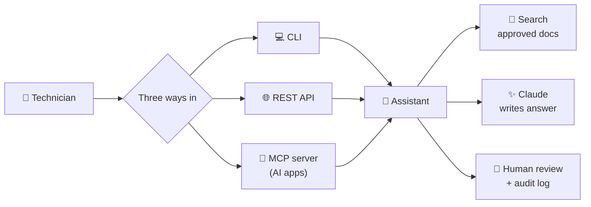
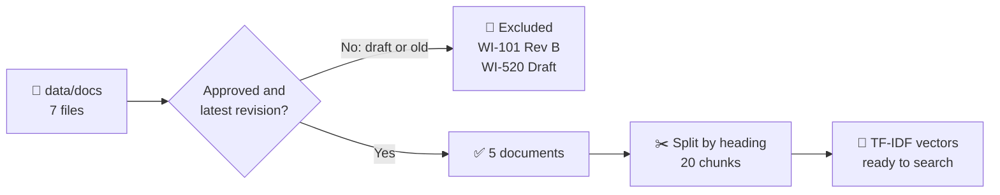
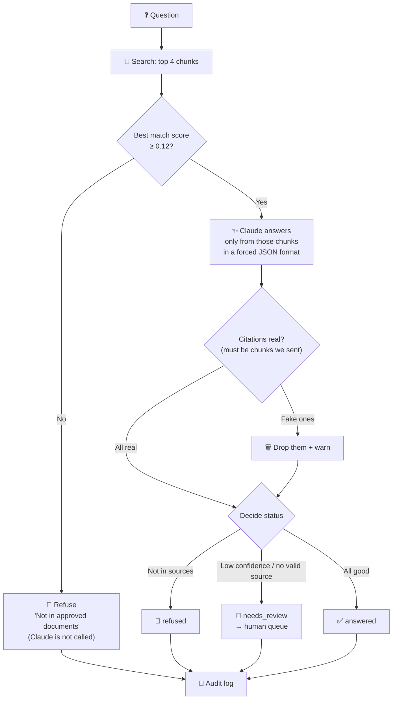
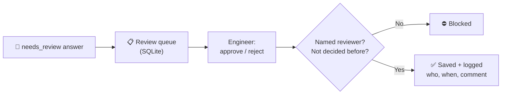
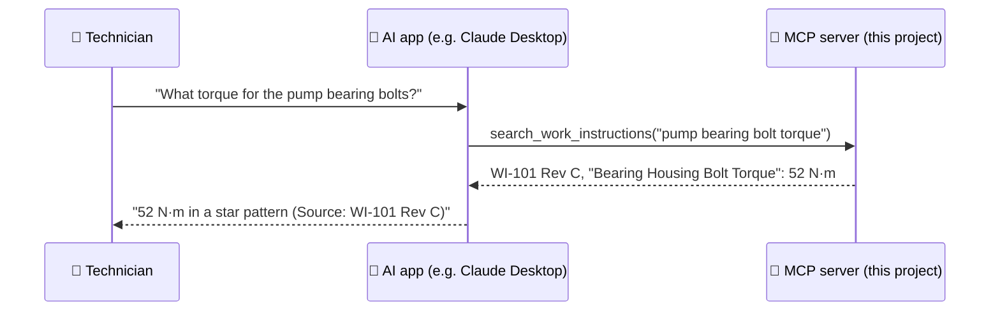

<div align="center">

# 🛠️ Work Instruction Assistant

**An AI assistant that answers technicians' questions only from approved, up-to-date work instructions, with a source for every answer and a human in the loop.**


[What it does](#-what-it-does) •
[How it works](#-how-it-works) •
[Safety layers](#-safety-layers) •
[Results](#-results) •
[Quick start](#-quick-start) •
[Project structure](#-project-structure)

</div>

---

## 💡 What it does

A technician asks a question in plain English:

> **"What torque should I use on the pump bearing housing bolts?"**

The assistant replies with the answer **and the exact source**:

```json
{
  "answer": "Torque to 52 N·m in a star pattern, in two passes (50% then 100%).",
  "citations": [{ "doc_id": "WI-101", "revision": "C", "section": "Bearing Housing Bolt Torque" }],
  "confidence": "high",
  "status": "answered"
}
```

> [!IMPORTANT]
> An **older revision (Rev B)** of the same document says **45 N·m**. The assistant never sees it, because only the **latest approved revision** is loaded. Using an outdated value is exactly the kind of mistake this project is built to prevent.

### The problem it solves

| ❌ Without it | ✅ With it |
|---|---|
| Technicians search through hundreds of documents | Answer in seconds |
| Old printouts with outdated values get used | Only the latest approved revision is used |
| A normal chatbot may **make up** a number | Answers **only** from approved documents |
| No proof where an answer came from | Every answer cites document, revision and section |
| AI guesses when unsure | Says **"I don't know"**, or sends it to a person |

---

## 🔄 How it works

### The big picture



### Step 1: Load documents (once, at startup)



### Step 2: Answer a question



### Step 3: Human review



> [!NOTE]
> The AI **can never approve anything**. There is no approve tool on the MCP server. Only a named person can approve, through the CLI or API.

### How an AI app uses it (MCP)



---

## 🛡️ Safety layers

| # | Layer | Where | What it stops |
|:-:|---|---|---|
| 1 | Only approved + latest revision indexed | `documents.py` | Outdated or draft procedures |
| 2 | Weak match → refuse, no AI call | `assistant.py` | Guessing on unrelated questions |
| 3 | Strict prompt: sources only, cite, copy numbers | `llm.py` | Answers from outside knowledge |
| 4 | Forced JSON output, validated with Pydantic | `llm.py` | Unparseable or malformed answers |
| 5 | Citations checked against retrieved chunks | `assistant.py` | Made-up sources |
| 6 | Low confidence → human review queue | `assistant.py` | Uncertain answers being relied on |
| 7 | Named human approval, no AI approval tool | `review.py`, `mcp_server.py` | AI making decisions |
| 8 | Append-only audit log | `review.py` | Missing traceability |

---

## 📊 Results

Evaluation set: **13 questions**, with 10 that must be answered and 3 trick questions that must be refused.

| Metric | Result | Meaning |
|---|:-:|---|
| **Retrieval hit@4** | **10 / 10** ✅ | Right document **and** revision found every time |
| **Correct refusal** (search only) | **2 / 3** ⚠️ | Off-topic and unknown questions refused |
| **Unit tests** | **10 / 10** ✅ | Every safety rule tested, no API key needed |

<details>
<summary><b>🔍 Known finding: why one refusal was missed</b></summary>

<br>

*"What belt deflection should I **set** on cooling fan F-10?"* only exists in a **draft** document, which is correctly excluded. But the word **"set"** matched another document above the score threshold.

**Lesson:** the score threshold alone isn't enough. In full mode, Claude's `insufficient_information` flag acts as a **second safety layer**. The real fix is **meaning-based search** (embeddings), listed in the roadmap.

</details>

---

## 🚀 Quick start

```bash
# 1. Set up
python3 -m venv .venv && source .venv/bin/activate
pip install -r requirements.txt

# 2. Free: no API key needed
pytest -q                                        # 10 tests
python -m wia.cli docs                           # see what's indexed vs excluded
python eval/run_eval.py --retrieval-only         # search + refusal scores
python -m wia.cli ask --offline "Who can remove a lockout lock?"

# 3. With Claude: add your key
cp .env.example .env                             # then paste ANTHROPIC_API_KEY
python -m wia.cli ask "What torque should I use on the pump bearing housing bolts?"
python eval/run_eval.py                          # full evaluation
```

<details>
<summary><b>🖥️ Example output (offline mode)</b></summary>

```json
{
  "question": "Who can remove a lockout lock?",
  "answer": "[offline mode] From WI-205 Rev A, 'Removing Locks': Only the person who applied a lock may remove it...",
  "citations": [{ "doc_id": "WI-205", "revision": "A", "section": "Removing Locks" }],
  "status": "answered",
  "sources_considered": [
    "WI-205 rev A / Removing Locks (0.3131)",
    "WI-101 rev C / Bearing Removal (0.161)",
    "WI-205 rev A / Steps (0.1156)",
    "WI-205 rev A / Purpose (0.094)"
  ]
}
```

</details>

<details>
<summary><b>🌐 Run the REST API</b></summary>

```bash
uvicorn wia.api:app --reload
# open http://localhost:8000/docs for an interactive test page
```

| Endpoint | Purpose |
|---|---|
| `POST /ask` | Ask a question |
| `GET /documents` | List indexed documents |
| `GET /reviews` | Pending human reviews |
| `POST /reviews/{id}/decision` | Approve / reject (named reviewer required) |
| `POST /reload` | Re-index after documents change |
| `GET /health` | Health check |

</details>

<details>
<summary><b>🤖 Use it from Claude Desktop (MCP)</b></summary>

Add to `claude_desktop_config.json` (use your own paths):

```json
{
  "mcpServers": {
    "work-instructions": {
      "command": "/ABSOLUTE/PATH/work-instruction-assistant/.venv/bin/python",
      "args": ["-m", "wia.mcp_server"],
      "cwd": "/ABSOLUTE/PATH/work-instruction-assistant",
      "env": { "WIA_OFFLINE": "1" }
    }
  }
}
```

| Tool | What it does |
|---|---|
| `search_work_instructions` | Find matching sections in approved docs |
| `get_work_instruction` | Get one full approved document |
| `ask_work_instructions` | Get a checked answer with sources |

All tools are **read-only** by design.

</details>

<details>
<summary><b>📄 Add your own documents</b></summary>

Put Markdown files in `data/docs/` with a header:

```markdown
---
doc_id: SOP-014
title: Forklift Daily Inspection
revision: B
status: approved        # only "approved" is used
effective_date: 2026-08-01
owner: Warehouse Safety
---
# Purpose
Check forklifts before each shift.

# Checklist
1. Check tire pressure.
```

Each `# Heading` becomes one searchable chunk.

</details>

---

## 📁 Project structure

```
work-instruction-assistant/
├── wia/                    🧠 the app
│   ├── config.py           ⚙️  settings (API key, top-k, min score)
│   ├── schemas.py          📐 data shapes (Pydantic)
│   ├── documents.py        📄 load, filter approved + latest, chunk
│   ├── retriever.py        🔎 TF-IDF vectors + cosine search
│   ├── llm.py              ✨ Claude with forced JSON / FakeLLM offline
│   ├── assistant.py        🧩 the pipeline and safety checks
│   ├── review.py           👤 review queue + audit log
│   ├── cli.py              💻 terminal commands
│   ├── api.py              🌐 FastAPI endpoints
│   └── mcp_server.py       🔌 MCP tools (read-only)
├── data/docs/              📚 sample work instructions (fictional)
├── eval/                   📊 13-question test set + scoring script
├── tests/                  ✅ unit tests
├── .env.example            🔑 template for your API key (.env is git-ignored)
├── Dockerfile              🐳 container
└── requirements.txt        📦 dependencies
```

---

## 🧰 Tech stack

| Area | Tools |
|---|---|
| Language | Python 3.11+ |
| Retrieval | scikit-learn (TF-IDF, cosine similarity) |
| LLM | Anthropic Claude (forced tool use for structured output) |
| Validation | Pydantic |
| API | FastAPI + Uvicorn |
| AI integration | Model Context Protocol (MCP) |
| Storage | SQLite (review queue), JSONL (audit log) |
| Testing | pytest + custom evaluation set |

---

## 🗺️ Roadmap

- [ ] **Meaning-based search:** embeddings + vector database (Chroma) and hybrid search
- [ ] **PDF ingestion** with page numbers in citations
- [ ] **Chat UI** (Streamlit) with a review page for engineers
- [ ] **Role-based access:** users only see documents they're allowed to
- [ ] **Local LLM option** (Ollama) so documents never leave the machine
- [ ] Revision state pulled from a real document-control / PLM system

---

<div align="center">

**Built as a learning project.** Sample documents describe a fictional facility.

</div>
